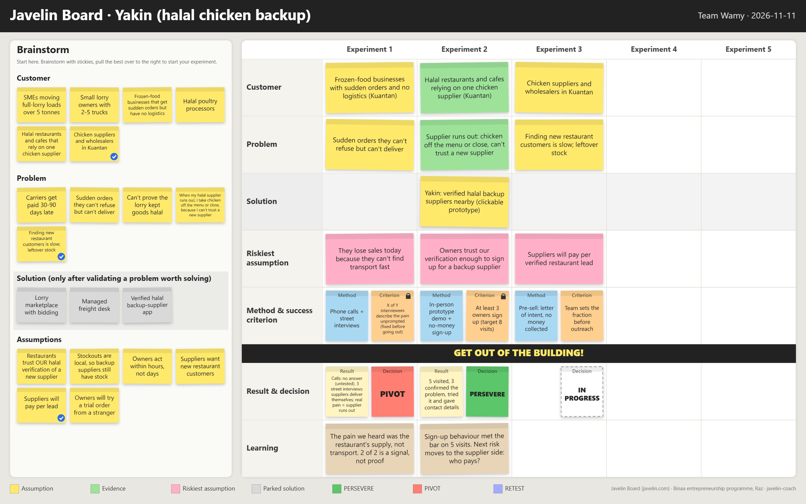
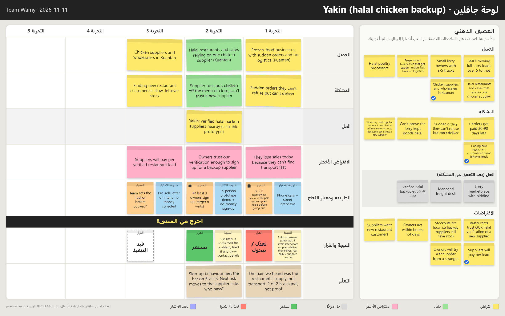

# Javelin Coach

An agent skill for Claude and Codex that coaches your team through the [Javelin Board](https://www.javelin.com), from choosing a customer to an honest persevere-or-pivot decision, and draws your board as a sticky-note image.



<details>
<summary>The same board in Arabic (right-to-left)</summary>



</details>

## What it does

| Mode | Say something like | You get |
|---|---|---|
| **Start** | "We're starting the Javelin board, our idea is…" | The 8 steps one at a time: customer, problem, solution parked, AI-drafted assumptions ranked on an importance × evidence matrix, a method from the experiment ladder, and a success criterion your team sets and locks. |
| **Interview kit** | «ساعدنا في المقابلات: من نقابل وماذا نسأل؟» | Who to ask and where to find them, an opener, past-behaviour questions in order, a note sheet and a tally line. Optional AI rehearsal, labelled as not evidence. |
| **Check** | "Check our board before we show the coach" | A 7-point pre-approval checklist, a score out of 7, and a rewritten sticky for every fix. |
| **Result** | "We're back from interviews, here are our notes" | Who counts (untested, out-of-segment and AI answers are excluded), the tally against your locked criterion, a **Persevere / Pivot / Retest** verdict with reasons, a learning draft, the next experiment and a facilitator pack. |

Every mode can end with a **board image** (PNG) in English or Arabic. The skill answers in Arabic or English only, matching the language you write in.

## Install

### Claude Code

Run in your terminal, then restart Claude Code:

```
claude plugin marketplace add soultntoure/javelin-coach
claude plugin install javelin-coach@javelin-coach
```

Inside a Claude Code session, the same commands are `/plugin marketplace add soultntoure/javelin-coach` and `/plugin install javelin-coach@javelin-coach`. Add `--scope project` to share the plugin with a project's collaborators.

### Codex

Run in your terminal, then restart Codex:

```
codex plugin marketplace add soultntoure/javelin-coach
codex plugin add javelin-coach@javelin-coach
```

If `codex plugin add` isn't recognised, update Codex, or run only the first command and install **javelin-coach** from the Plugins directory in the Codex desktop app.

### Claude.ai or the Claude desktop app

1. Download `javelin-coach.zip` from the [latest release](https://github.com/soultntoure/javelin-coach/releases/latest).
2. Go to **Settings → Capabilities** and turn on **Code execution and file creation**.
3. Go to **Customize → Skills**, click **+**, choose **Upload a skill** and select the ZIP.
4. Make sure the skill's toggle is on.

Skills are available on Claude's paid and free plans, but availability can vary by plan and an organisation owner can turn off skill uploads on Team and Enterprise.

### Manual (no marketplace)

```
git clone https://github.com/soultntoure/javelin-coach
```

Then copy `javelin-coach/skills/javelin-coach/` into `~/.claude/skills/` for Claude Code, or `~/.agents/skills/` for Codex.

## Usage

- **Claude Code:** type `/javelin-coach:javelin-coach` (plugin install) or `/javelin-coach` (manual install), or just describe what you're doing. Claude loads the skill when the request matches.
- **Codex:** describe what you're doing, or say "Use the javelin-coach skill: …".
- **Claude.ai / desktop:** start a new chat and say "Use Javelin Coach: …", or just describe what you're doing.

A short session:

```
You:    /javelin-coach:javelin-coach We're starting the Javelin board. Idea: an app for home bakers.
Coach:  Step 1, customer: who suffers most? "Home bakers" is too broad. Which of these could you find 10 of this week? …
You:    Home bakers selling cakes on WhatsApp in our city.
Coach:  Good, that passes the gate. Step 2, problem: what do they struggle with, in their words? (I've parked "the app" for now.)
Coach:  … Here's your board so far. [board.png]
```

## Board image

The skill keeps the board as JSON and renders it with `skills/javelin-coach/scripts/render_board.mjs` (Node, no dependencies). The script fills `assets/board.html` and, if Chrome or Edge is installed, takes a headless screenshot to a PNG:

```
node skills/javelin-coach/scripts/render_board.mjs board.json board.html board.png
```

Without Node or a browser (for example, in a sandbox that lacks one), the skill gives you the HTML file, which has a **Download PNG** button. Set the `JAVELIN_BROWSER` environment variable to point at a browser in a non-standard location.

The JSON shape is documented in the **Board image** section of [`SKILL.md`](skills/javelin-coach/SKILL.md), and [`assets/example-board.json`](skills/javelin-coach/assets/example-board.json) is a full example. `"lang": "ar"` switches to the printed board's Arabic labels and a right-to-left layout.

## Rules it enforces

- One specific customer segment, and a problem written in the customer's words.
- The solution stays parked until the problem is proven.
- One assumption per experiment.
- Your team sets the success criterion as a number before the test. The AI never picks it and never changes it afterwards.
- AI output, including the coach's own, is never evidence. Untested is not failed, and small samples are signals, not proof.
- No money is collected from interviewees. Pre-sell with sign-ups or letters of intent.

## Privacy

Don't paste interviewees' names, phone numbers or emails. Describe people by role ("restaurant owner, 12 staff"). The coach reminds you once per session and uses roles in everything it writes.

## Development

Requires Node 20 or later (tested on Node 22). No `npm install` needed.

| Task | Command |
|---|---|
| Run tests | `node --test` |
| Build the Claude.ai ZIP | `node scripts/build-zip.mjs` → `dist/javelin-coach.zip` |
| Validate manifests | `claude plugin validate . --strict` |
| Run the eval suite | `claude plugin eval . --allow-tools Bash Write Edit` |

The ZIP holds `javelin-coach/` at its root, uses forward-slash paths, and leaves out `evals/`. Don't build it with Windows PowerShell's `Compress-Archive`, which writes backslash paths.

The eval cases live in `skills/javelin-coach/evals/`. Each case runs Claude several times with and without the plugin, so a full run costs real usage. Use `--case <name>` and `--runs 1` while iterating.

Repository layout:

```
.claude-plugin/plugin.json        plugin manifest
.claude-plugin/marketplace.json   marketplace listing this one plugin (source "./")
skills/javelin-coach/             the skill (SKILL.md, references, assets, scripts, evals)
scripts/build-zip.mjs             builds dist/javelin-coach.zip
tests/                            renderer and ZIP tests
docs/images/                      example boards
```

## Credits and licence

Built by Team Wamy. The Javelin Board is by [javelin.com](https://www.javelin.com). Arabic wording, steps, rules and checklists come from the «ملتقى بناء لريادة الأعمال» workshop guide by راز للاستشارات التطويرية (Raz Development Consulting), used with permission. See [NOTICE.md](NOTICE.md).

This repository's own code and text are released under the [MIT licence](LICENSE). Third-party material is covered by [NOTICE.md](NOTICE.md).
